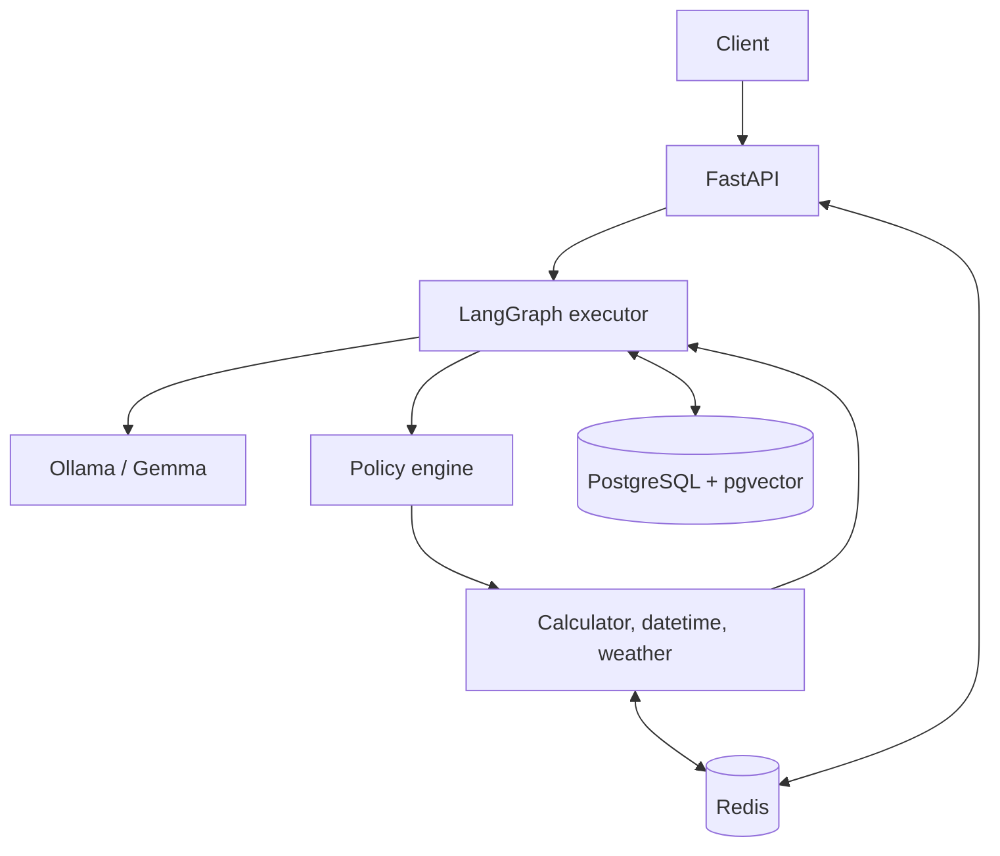

# AI Agent Harness

A FastAPI service that runs a local Gemma model through Ollama. LangGraph
coordinates the agent, and the harness enforces tool permissions, execution
budgets, timeouts, retries, and human approval. The API supports ordinary JSON
responses and server-sent events (SSE).

## Prerequisites

- For Docker setup, install Docker Engine with Compose v2 or Docker Desktop.
  Allocate enough memory and disk space for both Ollama models.
  [Install Docker Compose](https://docs.docker.com/compose/install/)
- For local Python development, use Python 3.12 or later, PostgreSQL with
  pgvector, Redis, and Ollama. Unix systems need the IANA timezone database
  for the datetime tool. [Install pgvector](https://github.com/pgvector/pgvector#installation)

## Start with Docker Compose

From the repository root, copy the environment template and set
`POSTGRES_PASSWORD` and `API_TOKEN` in `.env`. Use a private, high-entropy
token. Use `API_PORT` if port 8000 is already occupied.

```sh
cp .env.example .env
# Edit .env before starting the stack.
docker compose up --build -d
docker compose ps -a
curl -fsS http://127.0.0.1:8000/health
curl -fsS http://127.0.0.1:8000/ready
```

Compose waits for healthy PostgreSQL, Redis, and Ollama containers. The
`migrate` job applies Alembic migrations and the `ollama-models` job downloads
any missing models. Both jobs should exit successfully before the API starts.
The first run can take longer while the models download.

Only the API is published on the host by default, at `127.0.0.1:8000`.
PostgreSQL, Redis, and Ollama use named volumes. `docker compose down` stops
the stack and retains those volumes. `docker compose down -v` deletes the
stored data and model downloads for that Compose project.

## Run locally with Python

### Install Ollama and Gemma

Install Ollama for your operating system. If it is already running, use
the existing service. Otherwise run `ollama serve` in a separate terminal.
[Download Ollama](https://ollama.com/download)

```sh
ollama pull gemma4:e4b
ollama pull nomic-embed-text
ollama list
```

Python, the environment template, and Compose default to `gemma4:e4b`.
Set `OLLAMA_MODEL` to an installed tag if you use another model. [Gemma 4 tags](https://ollama.com/library/gemma4/tags)

### Install Python dependencies and start the API

Start PostgreSQL and Redis. Create the PostgreSQL database and role you plan
to use, and make pgvector available to the migration role. Copy the template
once, then edit `POSTGRES_*`, `REDIS_URL`, and `API_TOKEN` to match your
environment.

```sh
python3 -m venv .venv
source .venv/bin/activate
python -m pip install -r requirements.txt
# If you have not already created .env:
cp .env.example .env
# Edit .env before applying migrations.
python -m alembic upgrade head
make run
```

FastAPI reads `.env` from the working directory. Shell environment variables
take precedence. Use `REDIS_ENABLED=false` for local development without
Redis. The authenticated agent and memory routes still need PostgreSQL and
Ollama for their operations.

## Configuration

See [.env.example](.env.example) for an environment template.

| Settings | Purpose |
| --- | --- |
| `OLLAMA_BASE_URL`, `OLLAMA_MODEL`, `OLLAMA_EMBEDDING_MODEL` | Ollama endpoint, chat model, and 768-dimensional embedding model |
| `POSTGRES_HOST`, `POSTGRES_PORT`, `POSTGRES_DB`, `POSTGRES_USER`, `POSTGRES_PASSWORD` | Database connection and migrations |
| `REDIS_URL`, `REDIS_ENABLED`, `REDIS_KEY_PREFIX` | Redis connection, enable switch, and namespace for shared servers |
| `RATE_LIMIT_REQUESTS`, `RATE_LIMIT_WINDOW_SECONDS` | Shared per-user limit, 60 authenticated requests per 60 seconds by default |
| `WEATHER_CACHE_TTL_SECONDS` | Lifetime of cached public forecasts, 120 seconds by default |
| `API_TOKEN`, `API_USER_ID` | Default bearer credential and the stable user ID it represents |
| `API_ALLOWED_TOOLS`, `APPROVAL_REQUIRED_TOOLS` | JSON arrays of allowed and approval-gated tool names. An empty allowlist disables tools |
| `MAX_AGENT_STEPS`, `MAX_TOOL_CALLS`, `MAX_RETRIES`, `AGENT_TIMEOUT_SECONDS` | Run and tool execution budgets, defaulting to 10 steps, 5 tool calls, 2 retries, and 120 seconds |
| `MAX_CONVERSATION_TURNS`, `MEMORY_RETRIEVAL_LIMIT`, `MEMORY_MIN_SIMILARITY` | Prior conversation turns, semantic retrieval count, and minimum cosine similarity |
| `MAX_REQUEST_BODY_BYTES`, `LOG_LEVEL` | Request size limit (262144 bytes by default) and structured log level |
| `API_PORT`, `OLLAMA_IMAGE` | Compose-only host port and optional Ollama image override |

Compose configures the internal service addresses itself. The default bearer
backend represents one principal per deployment. Authentication and tool
permissions come from that principal. Approval-gated calls still require
the principal's underlying tool permission.

## API examples

Set `API_TOKEN` in your shell to the same value used by the API. Adjust
`API_URL` if you changed the listen address. The interactive OpenAPI
documentation is at `/docs`.

```sh
export API_URL=http://127.0.0.1:8000

curl -fsS "$API_URL/agent/run" \
  -H "Authorization: Bearer $API_TOKEN" -H 'Content-Type: application/json' \
  -d '{"thread_id":"examples","task":"What is 25 * 4?"}'

curl -fsS "$API_URL/agent/examples" \
  -H "Authorization: Bearer $API_TOKEN"

curl -fsS -N "$API_URL/agent/stream" \
  -H "Authorization: Bearer $API_TOKEN" -H 'Content-Type: application/json' \
  -d '{"thread_id":"stream-example","task":"What is 25 * 4?"}'
```

Omit `thread_id` to start a new thread. A completed HTTP request to
`POST /agent/run` returns the execution status, which can be `completed`,
`failed`, or `awaiting_approval`. Thread lookup returns the latest stored
run for the authenticated user.

SSE frames contain an event name, an ID in the form `run_id:sequence`, and a
JSON data object. They cover memory retrieval, model steps, model fragments,
tool calls and results, errors, and completion. Tool-enabled runs stream
structured JSON fragments. The validated user-facing answer is at
`agent_complete.metadata.run.final_answer`. A failed execution emits
`agent_error` followed by a failed completion. Disconnecting cancels unfinished
work. Event replay is unavailable.

### Approve or reject a tool call

Set `APPROVAL_REQUIRED_TOOLS=["calculator"]` in `.env` to try the approval
flow. Restart the local API or run `docker compose up -d` to apply the updated
configuration in Compose. Submit a calculator task and copy the thread ID and
`pending_approval.approval_id` into `THREAD_ID` and `APPROVAL_ID`. In a streamed run, the final
`approval_required` event contains those identifiers.

```sh
curl -fsS -X POST "$API_URL/agent/$THREAD_ID/approve" \
  -H "Authorization: Bearer $API_TOKEN" -H 'Content-Type: application/json' \
  -d "{\"approval_id\":\"$APPROVAL_ID\"}"
```

Use `/reject` instead of `/approve` to resume with a rejection observation.
Both operations keep the same run ID. Stale or duplicate decisions return
HTTP 409. Human wait time is excluded from the active run budget.

### Manage semantic memory

```sh
curl -fsS "$API_URL/memory" \
  -H "Authorization: Bearer $API_TOKEN" -H 'Content-Type: application/json' \
  -d '{"content":"Preferred programming language is Python."}'

curl -fsS "$API_URL/memory?limit=20&offset=0" \
  -H "Authorization: Bearer $API_TOKEN"

# Set MEMORY_ID to the ID returned by the create request.
curl -fsS -X DELETE "$API_URL/memory/$MEMORY_ID" \
  -H "Authorization: Bearer $API_TOKEN"
```

### Health and error responses

`GET /health` checks HTTP liveness. `GET /ready` checks PostgreSQL, the configured Ollama models,
and Redis when enabled.
Both endpoints are public. The API returns a server-generated
`X-Request-ID` and records it in structured logs. HTTP errors return
`code`, `detail`, and `request_id`. Validation issues report the source and
error type. Requests over the configured size limit, including chunked
bodies, return HTTP 413. Authenticated requests over their Redis quota
return HTTP 429 with `Retry-After`.

## Architecture and agent loop



The executor loads relevant memory and asks the model for a structured
decision. It can propose a tool or a final answer. The policy engine checks
tool permissions, validates arguments, and enforces limits before a tool
runs. It pauses approval-gated calls for a human decision. After the tool
runs, the observation goes back to the model for another decision. The
harness saves the result and episode on completion. Transient tool failures
can retry within both the per-tool and run retry limits. Each attempt shares
the original tool call's budget slot.

| Tool | Example arguments | Behavior |
| --- | --- | --- |
| Calculator | `{"expression":"25 * 4"}` | Evaluates bounded numeric arithmetic |
| Datetime | `{"timezone":"America/New_York"}` | Returns current date and timestamp in the named IANA zone |
| Weather | `{"location":"New York, US"}` | Returns current conditions and the day's maximum precipitation probability |

The weather tool calls Open-Meteo over outbound HTTPS. Redis caches public
forecasts and publishes best-effort lifecycle notifications. Internal
consumers can subscribe by user and thread through `RedisServices.subscribe()`.
[Open-Meteo documentation](https://open-meteo.com/en/docs)

## Memory and persistence

- **Short-term conversation memory** uses PostgreSQL-backed LangGraph checkpoints
  scoped by user and thread. Only completed exchanges enter the follow-up
  history. Checkpoints allow follow-ups and pending approvals to survive
  API restarts. PostgreSQL locks serialize turns on a thread across workers.
- **Episodic memory** stores the task, actions, result, and outcome when a
  run reaches its save step.
- **Semantic memory** stores explicit entries and standalone preference
  declarations, such as “My preferred programming language is Python.”
  A newer declaration updates the same preference. Retrieval uses
  user-scoped cosine similarity and only compares vectors from the same
  embedding model. Re-embed existing entries before switching models.

PostgreSQL stores runs, messages, tool calls, episodes, semantic memory, and
saved evaluations. It also stores lifecycle event summaries and audit entries
for run completion and approval activity. Detailed SSE fragments remain live
only. Thread lookup remains available after an API restart.

## Evaluation

```sh
python scripts/run_evals.py
python scripts/run_evals.py --json --min-success-rate 0.9
docker compose exec api python scripts/run_evals.py
```

The default dataset contains 20 cases. Cases specify the expected answer,
ordered tools, and optional criteria, tool-derived answer values, expected
memories, and efficiency limits. The report includes pass rate and
per-case scores for answer quality, tool use, trajectory, memory, and
efficiency. The CLI exits with status 1 if the pass rate falls below the
configured threshold, which defaults to 100%. Use `--dataset` to provide
a separate case file.

Use `--persist` with a migrated database to save runs and scores. Use a
dedicated `API_USER_ID` to isolate evaluation data from ordinary interaction
history. Retrieve persisted scores under that same user.

```sh
curl -fsS "$API_URL/evaluations?limit=20&offset=0" \
  -H "Authorization: Bearer $API_TOKEN"
```

## Testing

```sh
make check
make test
```

The standard suite uses controlled responses for model, forecast, and
storage interactions where appropriate. Set the opt-in flags for services
available from the host. Apply migrations to the test database first.

```sh
RUN_OLLAMA_TESTS=1 RUN_POSTGRES_TESTS=1 RUN_REDIS_TESTS=1 python -m pytest
RUN_COMPOSE_TESTS=1 COMPOSE_BASE_URL=http://127.0.0.1:8000 \
  python -m pytest tests/integration/test_compose.py
```

For the Compose smoke test, supply the API token used by the stack. To run
the first command against Compose-managed PostgreSQL or Redis, publish
their ports in a test override and point `POSTGRES_*` and `REDIS_URL` there.
The base Compose file keeps those ports internal.

## Troubleshooting

| Symptom | What to check |
| --- | --- |
| The API container has not started | Run `docker compose ps -a` and `docker compose logs migrate ollama-models`. The API waits for both setup jobs to finish |
| Ollama reports a missing model or cannot load it | Run `ollama list` or `docker compose exec ollama ollama list`. Check the configured tag and the host or VM's available RAM |
| PostgreSQL reports a missing table or vector extension | Check whether pgvector is installed and run `python -m alembic upgrade head` for the configured database. In Compose, inspect `docker compose logs migrate` |
| A protected route returns HTTP 401 | Check that the bearer token matches the API's `API_TOKEN` |
| `/ready` or a protected route returns HTTP 503 | Check Redis, database access, and whether `API_TOKEN` is configured. Use the error code and `X-Request-ID` to find the request in logs |
| A request returns HTTP 429 | Wait for the interval in the `Retry-After` header, or inspect the configured per-user limit |
| An approval returns HTTP 409 | Fetch the thread and use its current pending approval ID |
| Weather results are unavailable | Verify outbound HTTPS access to Open-Meteo |

## Continuous integration and license

GitHub Actions runs the standard suite and PostgreSQL and Redis integration
tests on Python 3.12. The Ollama and Compose tests can be run locally using
the opt-in flags above.

The project is distributed under the [MIT License](LICENSE).
